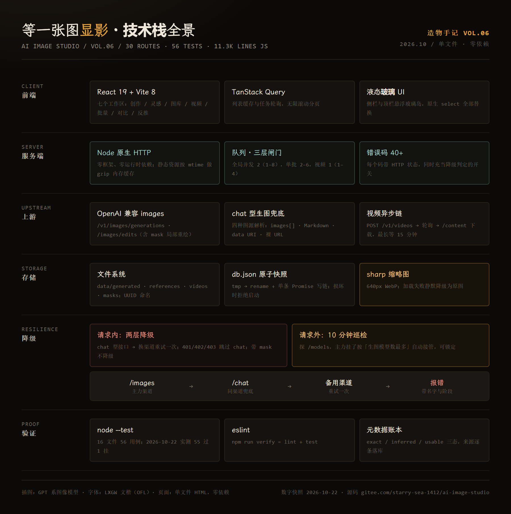

# 等一张图显影 · 造物手记 VOL.06

> 一个 AI 生图工作台的解剖报告：渠道体检、队列预算、降级链、元数据账本——从「一次点按」到「一张可复查的图」。

**[打开这一页 →](https://starrysea1412.github.io/imagestudio-story/)**



「画境」（[ai-image-studio](https://gitee.com/starry-sea-1412/ai-image-studio)）的解剖报告。生图产品都在比谁的模型多，可真用起来先坏掉的是那条流水线：排队、限流、降级、落盘、记账。这篇把这条线摊开——它怎么用一个字符串猜模型能力，怎么把并发当成预算，怎么在一张表里决定「换渠道还是立刻停手」，以及它凭什么说某句提示词是作者写的、某句是它猜的。

## 七章

| # | 章节 | 讲什么 |
|---|---|---|
| 01 | 一行提示词背后 | 一次点按展开成十六个动作；30 条 API 路由；取消的三种时态 |
| 02 | 渠道是会撒谎的接口 | 48 条渠道从三个只读探针导入；四张关键词表猜能力；15 秒体检与 404/401 的区别 |
| 03 | 并发是一笔预算 | 一次真实的 429；三层闸门；批任务「一轮只放一个」；取消不释放槽位 |
| 04 | 一张图的完整旅程 | base64 与 URL 两条交图路；为何拒绝 SVG；tmp→rename 原子写；sharp 可失败 |
| 05 | 打不过就换一条路 | 两张判定表、七种结局；chat 型生图兜底的有损之处；十分钟巡检能抓与抓不到 |
| 06 | 谁写了这句话 | A1111 / ComfyUI / InvokeAI 三套方言；exact 与 inferred 的界线；润色的三层容错 |
| 07 | 怎么证明它没撒谎 | 56 个测试与那 1 条红的；「能证明 / 证明不了」清单；四个没解决死角 |

## 四枚可玩小样

全部是**确定性模型**（不是录屏），参数与判定规则抄自源码、写在各章正文：

- **渠道体检台**：六条渠道，按四张关键词表推断能力。点一行设为主力，再让它挂掉，看巡检挑谁接班；勾「锁定」看它只能干等。特别注意那条叫 `auto` 的渠道——它其实能生图，却永远进不了候选池。
- **队列预算台**：拖任务数、并发、基准耗时，看点阵甘特图。点条子可以取消，然后注意**总时长一格都不变**：槽位仍被上游占着，只是结果被丢弃。
- **降级链**：切七种返回码、开关蒙版与备用渠道，逐步看判决。`200 但无图` 是整张表里唯一的死路——白名单会拦住换渠道。
- **元数据账本**：读图模式切五种来源，看 `exact / inferred / usable` 三个开关；润色模式切四种模型输出，看解析器在哪一层接住它、接不住时退回哪里。

## 技术实现

- `index.html` 单文件承载：零构建、零依赖、原生 JS；示意图为手写 SVG
- 暗房主题（`--bg #0c0a09` / 琥珀 `#e6a33b` / 瓷青 `#79b3a6`）——红光安全灯下，所有东西都偏琥珀
- 自托管 LXGW 文楷子集（1039 字形 × 2 字重，各约 245KB）
- 五张插图由 GPT 系图像模型生成（用的就是文中那类聚合渠道）
- 验收：本地静态服务 + Playwright 无头逐状态截图，0 pageerror、0 broken image、0 破字，桌面/移动 0 横向溢出

## 构建

```bash
node build/build.mjs         # build/*.html + style.css + demos.js → index.html
python build/verify.py       # 四枚小样逐状态截图 + 错误收集 → shots/
python build/scroll.py       # 逐屏截图（发现真实空白）→ shots/scroll/
python build/render-stack.py # docs/tech-stack.html → assets/tech-stack.png
```

字体子集按 `build/subsetsrc.txt`（全文与 JS 里出现的全部非 ASCII 字形 + ASCII）用 `fontTools.subset` 生成；原 TTF 放在 `build/fonts-src/`，不入库。

## 数字出处

正文里每个数字都能在本机复核（快照 2026-10-22）：

- `data/db.json` — 48 个 provider、4 条 generation（3 failed / 1 completed）、2 个 reference
- `src/server.js` — 30 条 API 路由（不含静态页）；一次 `POST /api/generations` 的处理链
- `npm test` — 56 用例、55 通过、1 失败（`server.test.js` 的计数断言 `3 !== 1`，原文照录，未修改）
- 五张插图的实际生成耗时：306 / 74 / 82 / 83 / 75 秒，前两次并发请求被 `429 user_concurrency_exceeded`

代码摘录为讲解节选，完整实现以仓库为准。插图由 GPT 系图像模型生成，字体为 LXGW 文楷（OFL）。
